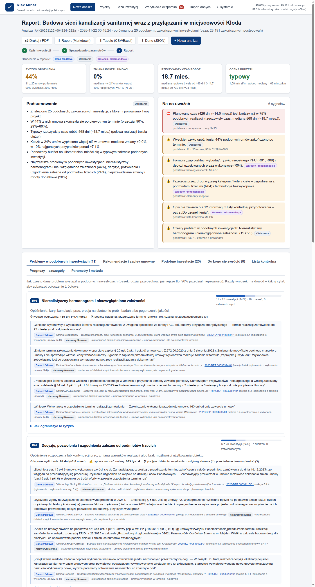
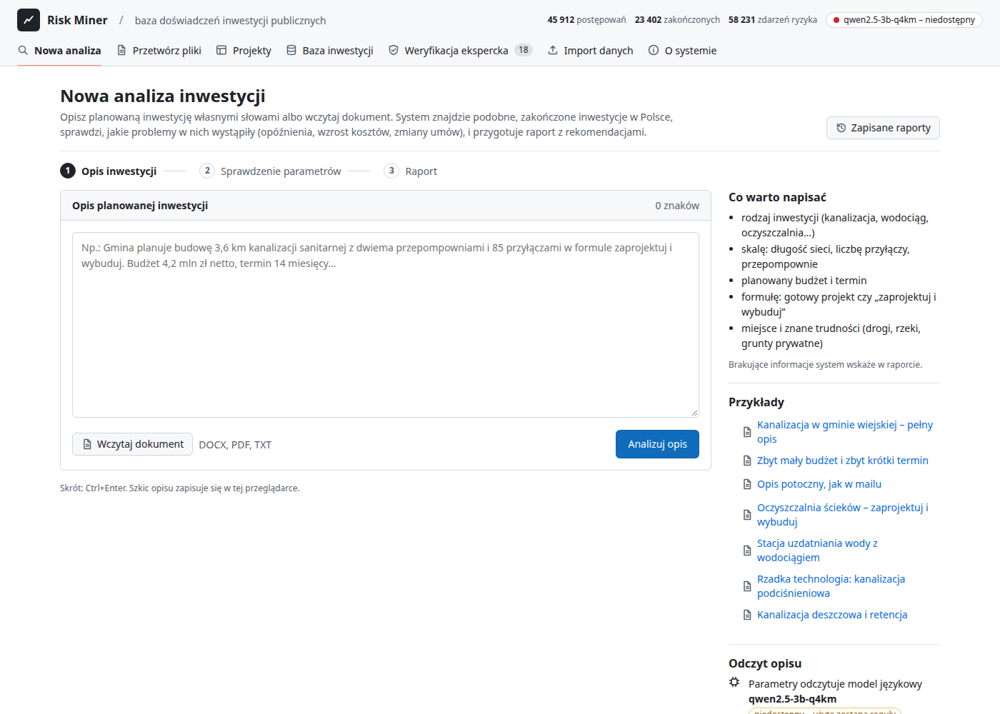
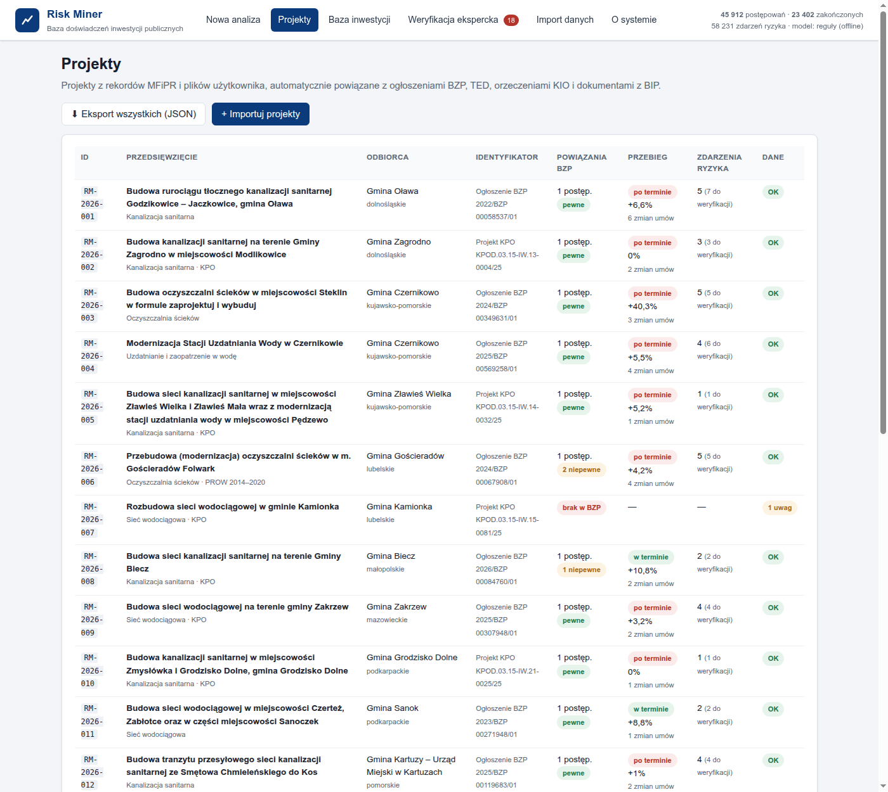
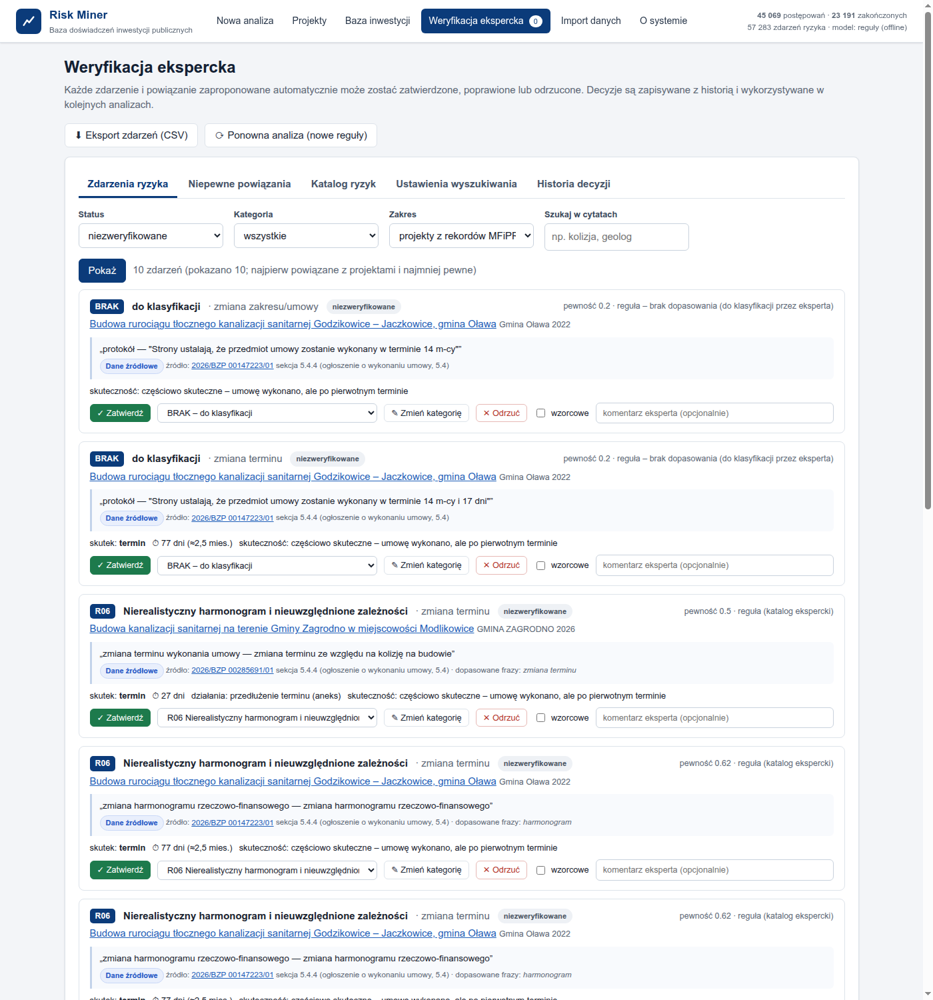
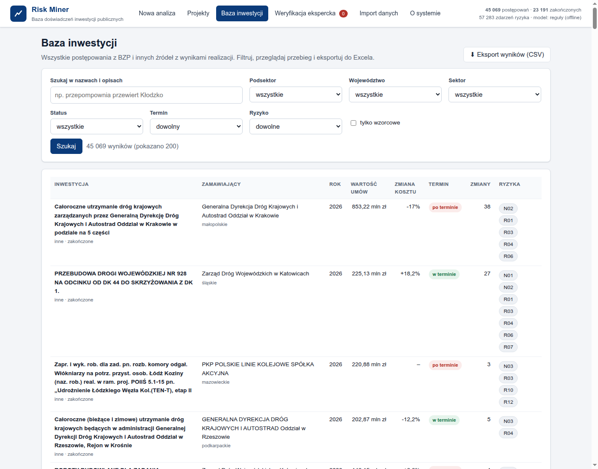

# Risk Miner – inteligentna baza doświadczeń inwestycji publicznych

**HackNation 2026 · wyzwanie Ministerstwa Funduszy i Polityki Regionalnej (Departament PPP)**

Urzędnik opisuje planowaną inwestycję **zwykłym językiem** (albo wczytuje wstępne dokumenty). Risk Miner znajduje
**najbardziej podobne, zakończone inwestycje w całej Polsce**, sprawdza w publicznych rejestrach, **co w nich poszło nie tak**
(opóźnienia, wzrost kosztów, aneksy, unieważnienia, odwołania do KIO), i przygotowuje raport: prognozę czasu i kosztu
z przedziałami niepewności, czerwone flagi, rekomendacje, propozycje zapisów umownych oraz **kontakty do zamawiających,
którzy realizowali podobne zadania**. Każda liczba i każdy wniosek prowadzi do źródła (ogłoszenie BZP, sekcja formularza,
strona dokumentu), a ekspert może każde zdarzenie zatwierdzić, poprawić albo odrzucić.

```
python -m riskminer build      # jednorazowo: baza z kopii ogłoszeń BZP (ok. 15 min)
python -m riskminer serve      # aplikacja: http://127.0.0.1:8000
```

> Działa **bez modelu językowego i bez internetu** (reguły eksperckie + statystyka). Model (lokalny Bielik przez Ollamę albo
> dowolne API zgodne z OpenAI) można włączyć w `config.toml` – bez zmian w kodzie.



**Baza po przetworzeniu kopii BZP wod-kan 2021–2026 i źródeł dodatkowych:** 113 tys. ogłoszeń BZP + 500 TED + 58 orzeczeń KIO →
45 912 postępowań w 6 sektorach (23 402 z wynikiem realizacji), 39 tys. umów, 28,6 tys. zmian umów, 58 tys. zdarzeń ryzyka z dowodami,
5,1 tys. zamawiających z danymi kontaktowymi.
Z 16 600 zakończonych umów wod-kan **35% wykonano po terminie** (średnio 88 dni), w **31% wypłacono więcej niż wartość umowy**,
a 6 668 postępowań unieważniono, bo oferty przekroczyły budżet.

Materiały: [prezentacja (PDF, 10 slajdów)](docs/prezentacja.pdf) · [architektura](docs/ARCHITEKTURA.md) ·
[raport z testu łączenia](docs/raport_testu_laczenia.md) · [przykładowe eksporty](docs/przyklady/) · [pliki testowe](examples/)

---

## Spis treści (zgodny z treścią zadania MFiPR)

| # | Wymaganie z treści zadania | Gdzie w rozwiązaniu | Stan |
|---|---|---|---|
| 0 | [Szybki start i test o 11:00](#0-szybki-start) | `python -m riskminer test-run` | ✅ |
| 1 | [Problem, zakres, główny scenariusz użytkownika](#1-problem-zakres-i-scenariusz-użytkownika) (rozdz. 1–2) | zakładka „Nowa analiza” | ✅ |
| 2 | [Oczekiwany rezultat](#2-oczekiwany-rezultat-rozdz-3) (rozdz. 3) | | |
| 2.1 | [Automatyczne zasilanie bazy (BZP, TED, KIO, BIP, NIK, KPOŚK, pliki)](#21-automatyczne-zasilanie-bazy) | `riskminer/build.py`, `sources/` | ✅ |
| 2.2 | [Łączenie rekordów, podstawa i poziom pewności](#22-łączenie-rekordów-i-poziom-pewności) | `riskminer/importer.py` | ✅ |
| 2.3 | [Ustrukturyzowana baza przypadków](#23-ustrukturyzowana-baza-przypadków) | `riskminer/db.py` | ✅ |
| 2.4 | [Ekstrakcja informacji o ryzykach (katalog otwarty)](#24-ekstrakcja-informacji-o-ryzykach) | `riskminer/classify.py`, `catalog.py` | ✅ |
| 2.5 | [Człowiek w procesie – panel eksperta](#25-człowiek-w-procesie--panel-eksperta) | zakładka „Weryfikacja ekspercka” | ✅ |
| 2.6 | [Analiza nowej inwestycji](#26-analiza-nowej-inwestycji) | `riskminer/report.py` | ✅ |
| 2.7 | [Rozwój: monitorowanie, kontakty, wielosektorowość](#27-rozwój-funkcje-dodatkowe) | `sources/bzp_api.py` | ✅ |
| 2.8 | [Przystępność](#28-przystępność) | `web/` | ✅ |
| 3 | [Wymagania techniczne](#3-wymagania-techniczne-rozdz-5) (rozdz. 5): model, integracje, identyfikatory, model danych, formaty, podobieństwo, prognozy, identyfikowalność, eksport, bezpieczeństwo, skalowalność | | ✅ |
| 4 | [Sposób testowania – jak przejść każdy test jury](#4-sposób-testowania-rozdz-6) (rozdz. 6) | | ✅ |
| 5 | [Kryteria oceny → co dostarczamy](#5-kryteria-oceny-rozdz-8) (rozdz. 8) | | |
| 6 | [Instalacja, konfiguracja, hosting](#6-instalacja-konfiguracja-hosting) | `config.example.toml`, `Dockerfile` | ✅ |
| 7 | [Architektura i struktura repozytorium](#7-architektura-i-struktura-repozytorium) | `docs/ARCHITEKTURA.md` | ✅ |
| 8 | [Źródła, modele, biblioteki, licencje](#8-źródła-modele-biblioteki-licencje) | | ✅ |
| 9 | [Działające vs zaprojektowane, ograniczenia](#9-co-działa-co-jest-zaprojektowane-ograniczenia) | | |

---

## 0. Szybki start

Wymagania: **Python 3.10+** (tylko biblioteka standardowa). Opcjonalnie: `pdftotext` (poppler) lub `pip install pypdf` do PDF,
LibreOffice do `.doc/.odt`, `tesseract` do OCR skanów, Ollama do lokalnego modelu językowego.

```bash
git clone <repo> && cd smart_kraken
cp config.example.toml config.toml            # opcjonalnie – domyślne wartości działają
# kopia ogłoszeń BZP wod-kan (2021–2026, 113 tys. ogłoszeń): https://bzp.cytr.us/paczka/risk_miner_bzp_kopia.zip
# rozpakuj obok repozytorium (../risk_miner_bzp_kopia/) albo podaj ścieżkę: --jsonl
python -m riskminer build                     # baza: data/riskminer.sqlite
python -m riskminer extras                    # (opcjonalnie) KIO, TED, BZP innych sektorów, KPOŚK z data_lake
python -m riskminer import Risk_Miner_dane_projekty.xlsx   # 22 projekty MFiPR + automatyczne wzbogacenie
python -m riskminer serve                     # http://127.0.0.1:8000
```

### Test jury o 11:00 (rekord dodatkowego projektu + opis nowej inwestycji)

**W interfejsie:** „Import danych” → przeciągnij plik z rekordem → projekt pojawia się w „Projekty” z powiązaniami →
przycisk **⬇ JSON / ⬇ Raport (MD) / ⬇ CSV**. Następnie „Nowa analiza” → **📄 Wczytaj dokument** (opis inwestycji) →
„Przygotuj raport” → „Wygeneruj raport” → **⬇ Raport (Markdown)** / CSV / JSON / Drukuj do PDF.

**Jednym poleceniem (bez zmian w kodzie):**

```bash
python -m riskminer test-run --project rekord_projektu.xlsx --investment opis_inwestycji.docx --out wyniki_testu/
# wyniki_testu/projekt_<ID>.json|.md|.csv  – eksport rekordu projektu (z powiązaniami, zmianami, zdarzeniami i źródłami)
# wyniki_testu/AN-....md|.json|.csv        – analiza nowej inwestycji
```

---

## 1. Problem, zakres i scenariusz użytkownika

| Nowa analiza | Projekty | Panel eksperta | Baza inwestycji |
|---|---|---|---|
|  |  |  |  |


**Problem.** Wiedza o tym, co faktycznie działo się w zrealizowanych inwestycjach, jest rozproszona: ogłoszenia o zamówieniu,
wyniku, **zmianie umowy** i **wykonaniu umowy** w BZP, TED, orzeczenia KIO, BIP-y gmin, kontrole NIK. Nikt jej nie zbiera, więc
gminy powtarzają te same błędy (niedoszacowane harmonogramy, kolizje, brak zgód właścicieli, aneksy).

**Zakres pilotażu.** Sektor wodno-kanalizacyjny (6 podsektorów MFiPR), z architekturą wielosektorową (w bazie są też drogi,
kubatura, energetyka, kolej – sektor i podsektor to dane, nie kod).

**Główny scenariusz (urzędnik, bez kompetencji technicznych):**

1. **Nowa analiza** → wkleja opis („Gmina planuje 3,6 km kanalizacji z dwiema przepompowniami, przewiert pod drogą wojewódzką,
   zaprojektuj i wybuduj, 4,2 mln zł netto, 14 miesięcy”) albo wczytuje DOCX/PDF.
2. **Sprawdza parametry** rozpoznane z opisu (każdy z cytatem i źródłem: reguła / model / poprawione) i ewentualnie je poprawia.
3. Dostaje **raport**: 4 wskaźniki (ryzyko opóźnienia, typowa zmiana kosztu, rzeczywisty czas, ocena budżetu), podsumowanie
   prostym językiem, czerwone flagi, problemy w podobnych inwestycjach z cytatami ze źródeł, rekomendacje, zapisy umowne,
   listę kontrolną braków w opisie i **kontakty** do zamawiających (z gotowym e-mailem).
4. Pobiera raport (Markdown/CSV/JSON) albo drukuje do PDF.

Ekspert (MFiPR/instytucja) korzysta z **Weryfikacji eksperckiej**, **Projektów** i **Bazy inwestycji**.

---

## 2. Oczekiwany rezultat (rozdz. 3)

### 2.1 Automatyczne zasilanie bazy

| Źródło | Jak pobieramy | Co z tego mamy |
|---|---|---|
| **BZP / e-Zamówienia** – kopia 113 278 ogłoszeń wod-kan (2021–2026) | `riskminer build` – parser formularzy BZP (etykiety pól, odporny na wersje formularzy) | postępowania, części, umowy, **zmiany umów (podstawa art. 455, przyczyna, opis, wartość)**, wykonanie (w terminie? należycie? wypłacono?), unieważnienia z uzasadnieniem, liczba ofert, kontakty |
| **BZP API na żywo** (`bzp.cytr.us`, awaryjnie `ezamowienia.gov.pl` z limitem 30/min) | `sources/bzp_api.py` – po numerze ogłoszenia, zamawiającym, tenderId | brakujące ogłoszenia (np. inne CPV), **monitorowanie** trwających postępowań |
| **TED** (API v3) | `sources/external.py: ted_search` + `data_lake/ted` | ogłoszenia unijne zamawiającego (powiązania z pewnością) |
| **KIO** (otwarte API SAOS) | `kio_search` + `data_lake/kio` | orzeczenia jako dokumenty + zdarzenia R11 z sentencją |
| **BIP samorządów** | `crawl_site` – robot startuje z adresu BIP/WWW zamawiającego (z ogłoszeń BZP), priorytetyzuje działy zamówień/inwestycji/umów i słowa kluczowe inwestycji (nazwy miejscowości), pobiera strony i PDF/DOCX | dokumenty (umowy, aneksy, uchwały, komunikaty) z fragmentami wskazującymi na ryzyko |
| **NIK** | wyszukiwarka wyników kontroli | powiązania do kontroli dotyczących zamawiającego |
| **KPOŚK / dane.gov.pl** | harvester (`tools/harvesters`) → `data_lake/kposk` | sprawozdania KPOŚK zarejestrowane jako źródła |
| **Pliki użytkownika** | „Import danych” (przeciągnij i upuść) | XLSX/XLS/CSV (projekty – dowolny układ kolumn), PDF, DOCX, DOC, ODT, RTF, TXT, HTML |

Proces jest **powtarzalny i idempotentny** (`python -m riskminer build`, `reanalyze`, przycisk „Wzbogać ponownie”) – bez ręcznego
wpisywania wyników. Każda operacja trafia do **rejestru źródeł** (URL, status, liczba rekordów, SHA-256, czas).

**Ponowna analiza po nowych dokumentach:** wgranie dokumentu do projektu uruchamia analizę jego fragmentów; „Ponowna analiza”
przelicza zdarzenia wszystkich powiązanych postępowań z aktualnymi regułami – **decyzje eksperta są zachowywane**.

### 2.2 Łączenie rekordów i poziom pewności

Kolejność (wymóg „podstawową metodą powinno być dopasowanie po identyfikatorze”):

1. **Numer ogłoszenia BZP** – normalizacja (`2022/BZP 58537` → `2022/BZP 00058537/01`), wyszukanie w bazie lub API, a następnie
   **weryfikacja z danymi podmiotu i zamówienia** (NIP zamawiającego, podobieństwo nazwy). Zgodne → *pewne (1,0)*; rozbieżne → *niepewne*, do eksperta.
2. **OCID / tenderId** – wszystkie ogłoszenia postępowania (wynik, zmiany, wykonanie) łączone po identyfikatorze postępowania.
3. **Projekt KPO / brak numeru** – kandydaci po **NIP**, ocena: podobieństwo nazwy i opisu (rzadkie słowa – nazwy miejscowości –
   ważą więcej), zgodność roku z naborem KPO, skala wartości, podsektor. Wynik z **uzasadnieniem i pewnością**; niepewne → eksperta.
4. **Walidacja identyfikatorów:** suma kontrolna NIP, format numeru BZP, **kod regionu w numerze KPO (IW.xx) vs województwo**,
   TERYT vs nazwa województwa, NIP z rekordu vs NIP w BZP.

**Wynik na 22 projektach MFiPR:** 14 powiązanych po numerze ogłoszenia (pewność 1,0); 1 przez odwołanie – numer z rekordu
(`2023/BZP 00110672/01`, Wolin) nie istnieje w BZP ani w API, ale jest przywołany w ogłoszeniu o wykonaniu umowy (błąd danych wykryty i opisany
w walidacji); 6 projektów KPO po NIP + nazwie + roku naboru + skali; 1 projekt KPO (Kamionka) bez pewnego kandydata – przekazany ekspertowi.
Dodatkowo 4 „powiązane postępowania” (np. powtórzone po unieważnieniu) czekają na decyzję eksperta.

Raport z testu łączenia (poprawne / niepewne / błędne): `python -m riskminer link-report` → [`docs/raport_testu_laczenia.md`](docs/raport_testu_laczenia.md).

### 2.3 Ustrukturyzowana baza przypadków

```
projects ─< project_links >─ procedures (postępowanie, OCID) ─< notices (ogłoszenia BZP/TED)
                                  │                          └< contracts (umowy / części) ─< changes (zmiany umów)
                                  └< risk_events (zdarzenie: fakt + kategoria ryzyka + przyczyna + skutek + działania + dowód)
documents (BIP, KIO, NIK, pliki) ─< risk_events (fragment + strona)
risk_catalog · subsectors · sectors · settings (wiedza ekspercka) · expert_log (historia decyzji) · sources (rejestr pobrań)
analyses (zapisane analizy) · monitor_events (monitoring) · organizations (zamawiający z kontaktami)
```

Szczegóły i diagram: [`docs/ARCHITEKTURA.md`](docs/ARCHITEKTURA.md).

### 2.4 Ekstrakcja informacji o ryzykach

* **Katalog ekspercki MFiPR R01–R15** (z materiału eksperckiego) z wzorcami rozpoznawania, typowymi skutkami, działaniami
  zaradczymi i propozycjami zapisów umownych – przechowywany w bazie, **edytowalny w panelu bez zmian w kodzie**.
* **Katalog otwarty:** system proponuje nowe kategorie (np. *N01 Warunki atmosferyczne i siła wyższa*, *N02 Wzrost cen i waloryzacja*,
  *N03 Koordynacja z innymi inwestycjami*) – status „propozycja”, ekspert zatwierdza/odrzuca. Zmiany niesklasyfikowane trafiają
  do kategorii **BRAK** jako materiał do nowych kategorii.
* **Zdarzenie = fakt + kategoria:** fakt udokumentowany w ogłoszeniu (zmiana terminu, zmiana wynagrodzenia, wykonanie po terminie,
  wypłata wyższa niż umowa, niewykonanie, nienależyte wykonanie, unieważnienie, odwołanie do KIO) + prawdopodobna przyczyna (R-kod).
* **Skutki:** wydłużenie terminu w dniach (z treści zmiany lub z dat umowy), koszt (wartość zmiany ze wzrostem ceny, różnica wypłaty).
* **Przyczyny:** treść „Przyczyny dokonania zmian”, podstawa prawna (art. 455 ust. 1 pkt 1–4, ust. 2) z interpretacją.
* **Działania zaradcze i ich skuteczność:** rozpoznawane działania (zmiana trasy, przewiert, roboty zamienne, aneks terminowy, kary,
  wykonanie zastępcze…) oceniane po wyniku umowy (wykonana w terminie i należycie / po terminie / nienależycie).
* Zmiany czysto administracyjne (rachunek bankowy, kierownik budowy, podwykonawca, VAT) **nie są** zdarzeniami ryzyka.
* Dokumenty (PDF/DOCX z BIP lub wgrane): zdania dopasowane do katalogu z **numerem strony**.

### 2.5 Człowiek w procesie – panel eksperta

Zakładka **„Weryfikacja ekspercka”**:

* **Zdarzenia ryzyka** – kolejka (najpierw powiązane z projektami i najmniej pewne): ✓ zatwierdź, ✎ zmień kategorię, ✕ odrzuć,
  komentarz, oznaczenie **wzorcowe**. Cytat → podgląd ogłoszenia źródłowego z podświetleniem.
* **Niepewne powiązania** projekt ↔ postępowanie: zatwierdź/odrzuć (z uzasadnieniem dopasowania).
* **Katalog ryzyk** – dodawanie/edycja kategorii, wzorców, działań i zapisów umownych; zatwierdzanie propozycji systemu.
* **Ustawienia wyszukiwania** – wagi podobieństwa (suwaki), wielkość grupy porównawczej, próg „mało danych”, premia dla wzorcowych.
* **Historia decyzji** – kto, kiedy, co zmienił (przed → po).
* Przypadki (postępowania) można oznaczyć jako **wzorcowe** – są premiowane w wyszukiwaniu i oznaczane w raportach.

Decyzje są **wykorzystywane w kolejnych analizach**: odrzucone zdarzenia znikają ze statystyk, poprawione kategorie zastępują
automatyczne, zatwierdzone są pokazywane jako dowody w pierwszej kolejności, a ponowna analiza nie nadpisuje decyzji.

### 2.6 Analiza nowej inwestycji

Raport (zakładka „Nowa analiza”, zapisywany jako rekord w `analyses`):

* **Grupa porównawcza** – zakończone inwestycje (z ogłoszeniem o wykonaniu umowy) dobrane hybrydowo; dla każdej: **dlaczego
  podobna** (wspólne słowa, ten sam podsektor, podobna skala kosztu i długości, rodzaj robót, formuła, wspólne elementy techniczne, region).
* **Prognoza czasu:** prawdopodobieństwo opóźnienia z **90% przedziałem Wilsona** i N, rozkład rzeczywistego czasu (mediana, P25–P75, P90),
  opóźnienie gdy wystąpiło, **realistyczny czas dla planowanego terminu**.
* **Prognoza kosztu i ocena kosztorysu:** zmiana kosztu (wypłacono vs umowa), udział umów ze wzrostem, spodziewany koszt końcowy,
  **koszt 1 km sieci** w podobnych inwestycjach i ocena budżetu (niski / typowy / wysoki), cena oferty vs szacunek, liczba ofert,
  **odsetek unieważnień** (w tym z powodu ceny powyżej budżetu).
* **Czerwone flagi** – np. „planowany czas krótszy niż w 75% podobnych realizacji”, „budżet na km niższy niż w 80% inwestycji”.
* **Problemy w podobnych inwestycjach** – kategorie ryzyka z częstością (N, CI), typowym wydłużeniem i kosztem, podjętymi działaniami
  i **cytatami ze źródeł** (numer ogłoszenia, sekcja formularza, status weryfikacji).
* **Rekomendacje** – do uzupełnienia przed przetargiem (lista kontrolna MFiPR), działania, **propozycje zapisów umownych**.
* **Kontakty** – zamawiający z najbardziej podobnymi inwestycjami (sukcesy i doświadczenia z problemami) z e-mailem, telefonem,
  stroną i **gotową wiadomością**; gdy danych jest mało – wyraźny komunikat i zachęta do kontaktu.
* **Rozróżnienie rodzaju informacji** w całym raporcie: *Dane źródłowe* / *Obliczenia* / *Wniosek / rekomendacja* (reguły lub model).

### 2.7 Rozwój (funkcje dodatkowe)

* **Moduł monitorowania** – dla postępowań w realizacji powiązanych z projektami sprawdza API BZP pod kątem nowych ogłoszeń
  (zmiana/wykonanie umowy), zapisuje je, przelicza zdarzenia i raportuje (zakładka „Import danych → Monitorowanie”).
* **Sieć kontaktów** – „do kogo się zwrócić” z gotowym e-mailem (pomysł z pytań do mentorów).
* **Wielosektorowość** – sektory i podsektory w bazie; BZP innych sektorów (drogi, kubatura, energetyka, kolej) ładowane z `data_lake`.
* **Przypadki wzorcowe**, **ocena skuteczności działań**, **wykrywanie błędów w danych wejściowych**.

### 2.8 Przystępność

Interfejs po polsku, jasny i stonowany (styl administracji), kroki 1-2-3, podpowiedzi „co warto napisać”, przykłady,
objaśnienia liczb („jak czytać medianę i przedział”), etykiety dla danych/obliczeń/wniosków, eksport do formatów biurowych
(CSV dla Excela, druk do PDF). Nie wymaga instalacji niczego poza Pythonem; strona działa w każdej przeglądarce.

---

## 3. Wymagania techniczne (rozdz. 5)

| Wymaganie | Realizacja |
|---|---|
| **Model w konfiguracji** | `config.toml` → `[llm] provider = none / ollama / openai`, `base_url`, `model`, `api_key_env` (klucz w zmiennej środowiskowej). Zmiana modelu bez zmian w kodzie. Przykład: [`config.example.toml`](config.example.toml). |
| **Gdzie przetwarzane są dane** | domyślnie **lokalnie** (bez modelu, bez wysyłania danych). Z Ollamą – lokalnie. Z API: UE (np. Mistral) lub poza UE (OpenAI) – opisane w konfiguracji i wyświetlane w aplikacji. |
| **Licencja** | MIT (kod). Dane: publiczne rejestry (BZP, TED, SAOS, BIP, NIK) – patrz [§8](#8-źródła-modele-biblioteki-licencje). |
| **Integracje** | plik MFiPR (.xlsx), pliki wsadowe (.xls .xlsx .csv .doc .docx .pdf .odt .rtf .txt .html), BZP/e-Zamówienia (kopia + API), TED, KIO (SAOS), NIK, BIP, KPOŚK. |
| **Łączenie po identyfikatorach** | numer ogłoszenia BZP/TED, OCID (tenderId), NIP, numer projektu KPO; normalizacja i weryfikacja (sumy kontrolne, NIP z BZP, region KPO). |
| **Model danych** | projekty, postępowania, ogłoszenia, kontrakty, zmiany kontraktów, zdarzenia, koszty i terminy (pola umów), dokumenty i źródła – osobne tabele z relacjami ([§2.3](#23-ustrukturyzowana-baza-przypadków)). |
| **Obsługiwane dane** | tabele + DOCX + PDF z warstwą tekstową; dodatkowo DOC/ODT/RTF (LibreOffice), HTML, **OCR skanów** (tesseract, jeśli zainstalowany). |
| **Analiza podobieństwa** | BM25 (SQLite FTS5, polski stemming) na tytułach/opisach/zmianach + podobieństwo cech strukturalnych; wyjaśnienie cech, które przesądziły. |
| **Wnioski i prognozy** | wyłącznie z danych grupy porównawczej; **liczebność próby (N)**, przedziały (kwantyle, Wilson 90%), komunikat „mało danych”. |
| **Identyfikowalność** | każdy rekord: identyfikator źródła, link, data pobrania, SHA-256 (dokumenty), sekcja formularza / strona dokumentu, cytat; status zatwierdzenia i historia decyzji. |
| **Struktura wyniku** | rekordy w bazie (filtrowanie w „Baza inwestycji”, kolejki eksperta), eksport **JSON / CSV / Markdown / PDF (druk)** – raporty, rekordy projektów, zdarzenia, baza przypadków. |
| **Bezpieczeństwo i wdrażalność** | rejestr źródeł i operacji, historia decyzji, ograniczanie zapytań (limit API BZP, opóźnienia BIP), brak danych osobowych poza publicznymi danymi kontaktowymi zamawiających, brak uzależnienia od dostawcy (biblioteka standardowa, SQLite, dowolny model). |
| **Skalowalność** | baza ~45 tys. postępowań, analiza ~1–2 s; sektory/podsektory/reguły jako dane; SQLite → PostgreSQL bez zmiany modelu; wpisy powstają automatycznie z przetwarzania materiałów (bez ręcznego łączenia). |

---

## 4. Sposób testowania (rozdz. 6)

| Test jury | Jak go przeprowadzić |
|---|---|
| **Demonstracja dwóch ścieżek** | (1) „Import danych” → `Risk_Miner_dane_projekty.xlsx` → automatyczne wzbogacenie → „Projekty” → eksport. (2) „Nowa analiza” → przykład lub dokument → raport → eksport. |
| **Test integracji** | `python -m riskminer build` (kopia BZP) i „Wzbogać ponownie” (API BZP, TED, KIO, BIP, NIK) – powtarzalne, bez ręcznego wpisywania; rejestr operacji w „Import danych”. |
| **Test łączenia** | „Projekty” → zakładka „Powiązania ze źródłami” (podstawa, pewność, uzasadnienie) albo `python -m riskminer link-report`. |
| **Test kompletności przypadku** | „Projekty” → projekt → „Przebieg”: ogłoszenia (o zamówieniu, wyniku, zmianie, wykonaniu), umowy, zmiany, wykonanie; „Zdarzenia ryzyka”. |
| **Test nowej inwestycji** | raport: grupa porównawcza z wyjaśnieniem, dane porównawcze, flagi, rekomendacje, przedziały odchyleń. |
| **Test źródłowy** | kliknięcie numeru ogłoszenia przy cytacie → treść ogłoszenia z podświetlonym fragmentem + link do e-Zamówień. |
| **Test pracy eksperta** | „Weryfikacja ekspercka” → zatwierdź / popraw / odrzuć zdarzenie lub niepewne powiązanie; historia decyzji. |
| **Test założeń** | wagi, katalog i reguły edytowalne; sektory jako dane; [§3](#3-wymagania-techniczne-rozdz-5) i [§9](#9-co-działa-co-jest-zaprojektowane-ograniczenia). |

---

## 5. Kryteria oceny (rozdz. 8)

| Kryterium (waga) | Co dostarczamy |
|---|---|
| Automatyczne pozyskiwanie, łączenie i organizacja danych (20%) | 113 tys. ogłoszeń → ~45 tys. postępowań z umowami, zmianami i wykonaniem; API na żywo; TED/KIO/BIP/NIK; łączenie po identyfikatorach z walidacją i pewnością; powtarzalny proces. |
| Jakość analizy dokumentów i identyfikacji zdarzeń (20%) | katalog MFiPR + otwarte kategorie; fakt + przyczyna + skutek (dni, zł) + działania + skuteczność; cytat i sekcja/strona; komunikowanie niepewności. |
| Użyteczność analizy planowanej inwestycji (25%) | grupa porównawcza z wyjaśnieniem, ocena kosztorysu (koszt/km) i harmonogramu, flagi, ryzyka z dowodami, działania, zapisy umowne, lista kontrolna, kontakty. |
| Kontrola ekspercka, edytowalność, modułowość (20%) | panel eksperta (zdarzenia, powiązania, katalog, wagi, historia), wzorcowe przypadki, reguły w bazie, sektory jako dane. |
| UX/UI, jakość techniczna, rozwój (15%) | prosty interfejs w 3 krokach, eksport JSON/CSV/MD/PDF, zero zależności, Docker, dokumentacja. |

---

## 6. Instalacja, konfiguracja, hosting

* **Lokalnie:** `python -m riskminer serve` (opcje `--host 0.0.0.0 --port 8000 --no-browser`).
* **Docker (cały projekt):** `docker compose up -d --build` – Risk Miner (http://127.0.0.1:8000), ekstraktor LLM
  (http://127.0.0.1:8001) i Ollama z modelem Bielik (pobierany przy pierwszym starcie). Szczegóły w sekcji 6a.
* **Serwer:** dowolny VPS z Pythonem 3.10+; aplikacja to jeden proces i jeden plik bazy (SQLite). Za odwrotnym proxy (nginx) z TLS.
* **Konfiguracja:** `config.toml` (kopia `config.example.toml`) lub zmienne `RISKMINER_<SEKCJA>_<KLUCZ>`.

Polecenia CLI:

| Polecenie | Opis |
|---|---|
| `python -m riskminer serve` | aplikacja WWW |
| `python -m riskminer build [--jsonl PLIK] [--limit N]` | budowa bazy z kopii BZP (JSONL z API e-Zamówień) |
| `python -m riskminer reanalyze` | ponowna analiza z aktualnymi regułami (zachowuje decyzje eksperta) |
| `python -m riskminer import PLIK.xlsx [--offline] [--no-external]` | import projektów + wzbogacenie |
| `python -m riskminer analyze OPIS.docx --out katalog/` | analiza nowej inwestycji → MD/JSON/CSV |
| `python -m riskminer export-project RM-2026-001 --out katalog/` | eksport rekordu projektu |
| `python -m riskminer test-run --project P.xlsx --investment O.docx --out wyniki/` | pełna ścieżka testowa |
| `python -m riskminer extras` | KIO, TED, BZP wielosektorowe, KPOŚK z `data_lake` |
| `python -m riskminer link-report --out docs/raport_testu_laczenia.md` | raport z testu łączenia |

---


## 6a. Docker – cały projekt

Wymagany Docker Desktop (Windows: backend WSL 2). Pliki: `docker-compose.yml`, `docker-compose.gpu.yml`,
`Dockerfile` (Risk Miner), `tools/ekstraktor_llm/Dockerfile`, `.env.example`.

| Usługa | Adres | Dane |
|---|---|---|
| `riskminer` | http://127.0.0.1:8000 | baza w wolumenie `riskminer-data` |
| `ekstraktor` | http://127.0.0.1:8001 | `tools/ekstraktor_llm/wyniki`, `debug` |
| `ollama` (+ `ollama-pull`) | tylko w sieci Dockera | modele w wolumenie `ollama-models` |

```
copy .env.example .env                                   # opcjonalnie: model, porty, ścieżki danych
docker compose up -d --build                             # start (pierwszy raz: budowa obrazów + pobranie modelu)
docker compose -f docker-compose.yml -f docker-compose.gpu.yml up -d --build   # model na karcie NVIDIA
docker compose --profile setup run --rm baza             # jednorazowo: baza z kopii BZP + import 22 projektów
docker compose logs -f ollama-pull                       # postęp pobierania modelu
docker compose down                                      # stop (dane i modele zostają w wolumenach)
```

* Kopia BZP (`risk_miner_bzp_kopia.zip`) rozpakowana obok repozytorium: `../risk_miner_bzp_kopia/bzp_kopia/notices.jsonl`
  (inna ścieżka: `BZP_KOPIA_DIR` w `.env`). Materiały konkursowe: `MATERIALY_DIR`.
* Ollama zainstalowana w Windows (model już pobrany): w `.env` ustaw `LLM_URL=http://host.docker.internal:11434`
  i uruchamiaj `docker compose up -d --build --no-deps riskminer ekstraktor`.
* Bez modelu: `RISKMINER_LLM_PROVIDER=none` (Risk Miner działa na regułach; ekstraktor wymaga modelu).
* Polecenia CLI w kontenerze: `docker compose exec riskminer python -m riskminer link-report`.
* Kopia bazy na dysk: `docker compose cp riskminer:/app/data/riskminer.sqlite .`
* LibreOffice (.doc/.odt/.rtf) nie jest w obrazie domyślnie: `docker compose build --build-arg LIBREOFFICE=1 riskminer`.

## 7. Architektura i struktura repozytorium

```
riskminer/              pakiet (wyłącznie biblioteka standardowa Pythona)
  bzp.py                parser formularzy BZP (4 typy ogłoszeń, wiele części, zmiany umów)
  build.py              budowa bazy: ogłoszenia -> postępowania, umowy, zmiany, zdarzenia, indeks FTS5
  catalog.py            wiedza ekspercka (seed): R01–R15, propozycje N01–N03, podsektory, cechy, lista kontrolna
  classify.py           klasyfikacja: podsektor, rodzaj robót, formuła, elementy, długość, przyłącza, ryzyka (reguły z bazy)
  query.py              opis w języku naturalnym -> parametry (z cytatami); opcjonalnie model językowy
  search.py             wyszukiwanie hybrydowe + wyjaśnienia podobieństwa
  report.py             raport: prognozy (N, CI), flagi, ryzyka z dowodami, rekomendacje, kontakty, lista kontrolna
  importer.py           import tabel/dokumentów, walidacja, łączenie z pewnością, wzbogacanie, rekord projektu
  docs.py               odczyt DOCX/PDF/XLSX/XLS/CSV/DOC/ODT/RTF/HTML (+ OCR)
  sources/              BZP API (+ monitoring), TED, KIO/SAOS, BIP (robot), NIK, data_lake
  export.py             JSON / CSV / Markdown
  server.py             API + serwer strony
  llm.py, config.py     wymienny model językowy, konfiguracja
web/                    interfejs (HTML + CSS + JS, bez frameworków)
tools/ekstraktor_llm/   samodzielne narzędzie: ekstrakcja parametrów z opisu lokalnym LLM (Bielik) z weryfikacją cytatów
tools/harvesters/       skrypty, które zasiliły data_lake (KIO, KPOŚK, NIK, RIO, TED, BK2021, BZP wielosektorowe)
docs/                   architektura, raport z testu łączenia, przykładowe eksporty
```

---

## 8. Źródła, modele, biblioteki, licencje

| Element | Licencja / warunki |
|---|---|
| Kod Risk Miner | MIT |
| BZP / e-Zamówienia (API mo-board), kopia `bzp.cytr.us` | informacja publiczna (ustawa o dostępie do informacji publicznej, Pzp) |
| TED (Publications Office of the EU) | ponowne wykorzystanie dozwolone (Decyzja Komisji 2011/833/UE) |
| SAOS (orzeczenia KIO) | dane publiczne, otwarte API |
| BIP, NIK, dane.gov.pl (KPOŚK) | informacja publiczna / otwarte dane |
| Python 3 (biblioteka standardowa, SQLite FTS5) | PSF / public domain |
| Testy | `python -m unittest discover tests` (parser BZP, kwoty, okresy, NIP/KPO, klasyfikacja, ekstrakcja) |
| Opcjonalnie: pypdf (BSD), poppler-utils (GPL, narzędzie zewnętrzne), LibreOffice (MPL), tesseract (Apache 2.0) | |
| Opcjonalnie: model Bielik (SpeakLeash, Apache 2.0) przez Ollamę (MIT) lub API zgodne z OpenAI | wg dostawcy |

Dane osobowe: system przetwarza wyłącznie publiczne dane kontaktowe zamawiających (instytucji) z ogłoszeń BZP.

---

## 9. Co działa, co jest zaprojektowane, ograniczenia

**Działa (zademonstrowane):** wszystko opisane w §2–§4.

**Zaprojektowane / do rozwinięcia:**

* Baza Konkurencyjności 2021 – aplikacja SPA bez publicznego API; konektor zaprojektowany (harvester diagnozuje endpoint), nie wchodzi do analiz.
* Pełne pobieranie dokumentów postępowań z platform zakupowych (SWZ, PFU, PPU) – linki do platform są w bazie (`platform_url`),
  pobieranie wymaga obsługi wielu platform (Logintrade, platformazakupowa.pl, e-Zamówienia).
* Model językowy do klasyfikacji zdarzeń niesklasyfikowanych (kategoria BRAK) – interfejs gotowy (`llm.py`), domyślnie wyłączony.
* PostgreSQL + pgvector zamiast SQLite dla wielu sektorów i milionów dokumentów.

**Ograniczenia danych (komunikowane w raportach):** brak informacji w ogłoszeniu ≠ brak zdarzenia; ogłoszenie o wykonaniu umowy
nie zawsze podaje przyczyny; szacunki zamawiających są netto, umowy brutto (porównujemy brutto, szacunek × 1,23); reguły rozpoznają
zdarzenia z określoną pewnością – dlatego **każde zdarzenie czeka na weryfikację eksperta**, a statystyki pokazują, ile z nich zatwierdzono.

---

*Narzędzie `tools/ekstraktor_llm` (ekstrakcja parametrów z opisu lokalnym modelem Bielik z weryfikacją cytatów) – pierwotna
aplikacja zespołu, zachowana jako samodzielny moduł.*
