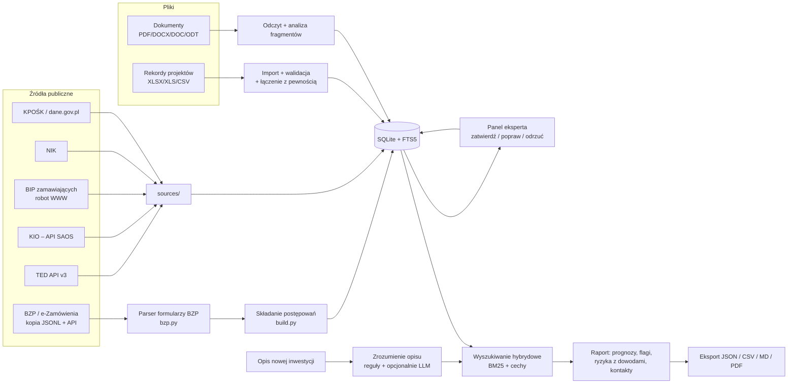
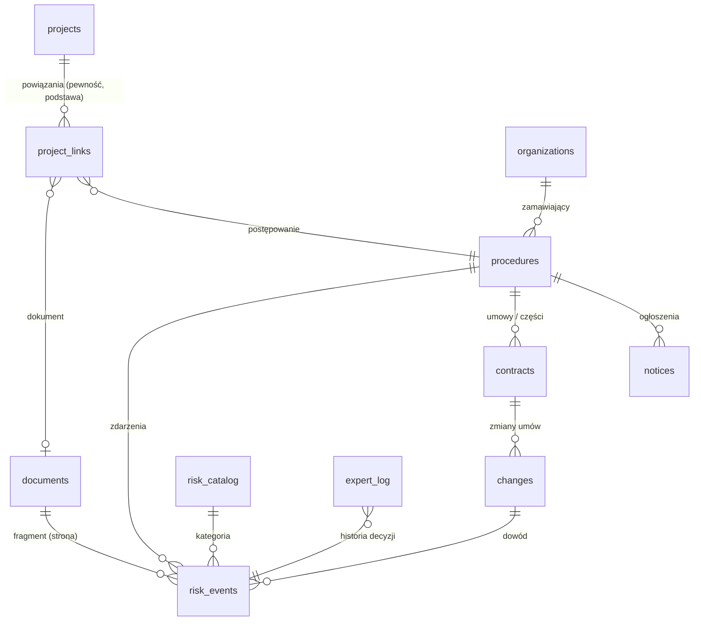

# Architektura i model danych Risk Minera

## Przepływ danych

## Model danych

| Tabela | Zawartość | Kluczowe pola identyfikowalności |
|---|---|---|
| `projects` | rekordy przedsięwzięć (plik MFiPR lub inny) | `source_file`, `raw` (oryginalny wiersz), `validation` |
| `project_links` | projekt ↔ postępowanie / dokument / TED / NIK | `match_basis`, `confidence`, `evidence`, `status` (auto / uncertain / approved / rejected), `reviewer` |
| `procedures` | postępowanie (OCID/tenderId) – agregaty przebiegu | `tender_id`, `source_system`, `status`, `has_outcome`, `exemplary` |
| `notices` | ogłoszenia BZP (4 typy) i TED | `notice_number`, `url`, `fetched_at`, `text_z` (treść do podglądu dowodu) |
| `contracts` | umowy/części: wykonawca, data, wartość, wykonanie, terminowość, wypłata | `result_notice`, `perf_notice` |
| `changes` | zmiany umów: podstawa art. 455, przyczyna, opis, wartość, skutek, działania | `source_notice`, `section` (pole formularza) |
| `risk_events` | zdarzenie: fakt (`event_type`) + kategoria (`risk_code`) + przyczyna + skutek (dni/zł) + działania + skuteczność | `quote`, `source_ref`, `source_url`, `locator`, `confidence`, `method`, `status`, `reviewer`, `reviewed_at` |
| `documents` | dokumenty BIP/KIO/NIK/pliki (strony) | `url`, `fetched_at`, `sha256`, `pages` |
| `organizations` | zamawiający (NIP, REGON, adres, e-mail, telefon, WWW/BIP) | z ogłoszeń BZP |
| `risk_catalog`, `subsectors`, `sectors`, `settings` | wiedza ekspercka i ustawienia – edytowalne | `updated_at`, `proposed_by` |
| `expert_log` | historia decyzji (przed → po, komentarz) | `ts`, `reviewer` |
| `sources` | rejestr operacji pobierania | `url`, `http_status`, `records`, `sha256`, `started_at`, `finished_at` |
| `analyses` | zapisane analizy nowych inwestycji (pełny wynik JSON) | `analysis_id` |
| `monitor_events` | nowe ogłoszenia wykryte przez monitoring | `notice_number` |

## Postępowanie → wskaźniki przebiegu

* **Opóźnienie**: pole 5.3 ogłoszenia o wykonaniu („czy wykonano w pierwotnie określonym terminie”) – fakt; liczba dni:
  (data wykonania − data zawarcia umowy) − okres realizacji z umowy.
* **Zmiana kosztu**: (łączna wartość wypłacona 5.5 − wartość umowy 4.4) / wartość umowy.
* **Zmiany umowy**: lista z sekcji 5.4 ogłoszenia o wykonaniu + ogłoszenia o zmianie umowy (deduplikacja po treści przyczyny).
* **Unieważnienia**: sekcja V ogłoszenia o wyniku – podstawa (art. 255 pkt …) i uzasadnienie, osobno dla każdej części.

## Wyszukiwanie podobnych inwestycji

1. Kandydaci: FTS5/BM25 na rdzeniach słów (stemming: obcięcie do 6 znaków po usunięciu diakrytyków) w tytułach (waga 4),
   opisach (1) i treści zmian (0,4) + kandydaci strukturalni (ten sam podsektor, wartość w przedziale ×/÷4).
2. Ocena: `Σ waga × podobieństwo` dla: treści, podsektora (1 / 0,6 pokrewny), skali (log-odległość wartości brutto i długości sieci),
   rodzaju robót, formuły „zaprojektuj i wybuduj”, elementów technicznych (Jaccard), województwa, aktualności; premia dla wzorcowych.
3. Wyjaśnienie: lista cech, które przesądziły („ten sam podsektor”, „podobna skala kosztu: 4,1 mln zł (planowane 5,2 mln zł)”…).
4. Grupa porównawcza: wyniki ≥ 60% najlepszego (min. 5) – tylko zakończone postępowania (z ogłoszeniem o wykonaniu umowy).

## Skalowanie

* Wszystkie reguły, sektory i wagi są danymi w bazie – nowy sektor = nowe wiersze `sectors`/`subsectors` + wzorce.
* Parser BZP rozpoznaje pola po etykietach, więc działa dla wszystkich sektorów i wersji formularzy.
* SQLite (WAL) obsługuje dziesiątki tysięcy postępowań z analizą w 1–2 s; warstwa `db.py` jest cienka – przejście na PostgreSQL
  (FTS przez `tsvector`, opcjonalnie pgvector) nie zmienia modelu danych.
